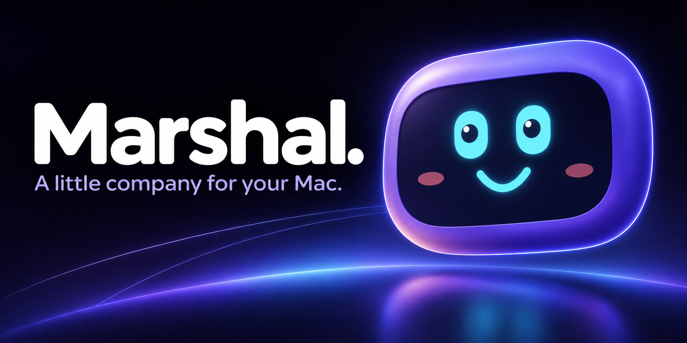
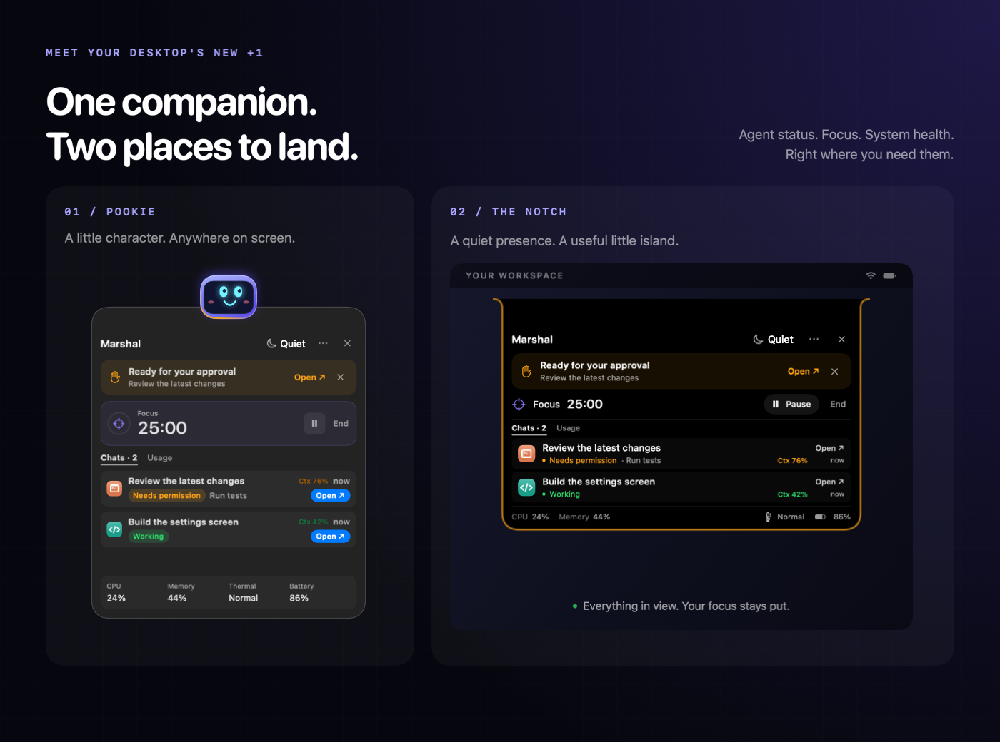
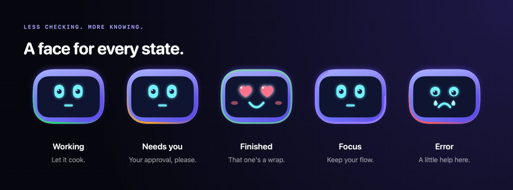
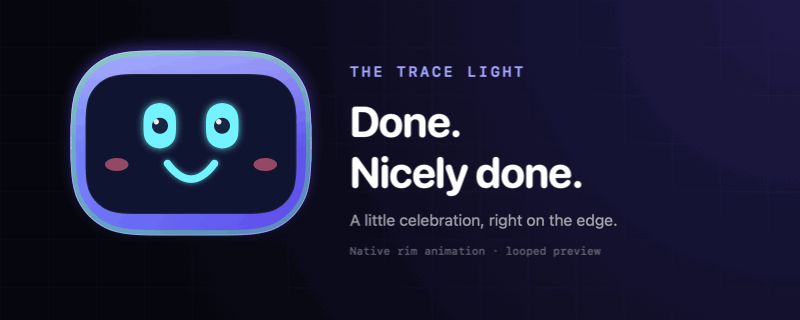
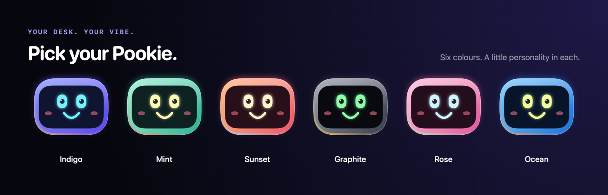

<p align="center">
  
</p>

<h1 align="center">Meet Pookie. Keep your flow.</h1>

<p align="center">
  <strong>A native macOS companion for your agents, your focus, and your Mac.</strong><br>
  Claude Code and Codex status, usage limits, and a little personality — always within a glance.
</p>

<p align="center">
  macOS 14+ &nbsp;·&nbsp; Swift 6 + SwiftUI &nbsp;·&nbsp; Open source &nbsp;·&nbsp; MIT
</p>

<p align="center">
  <a href="#quick-start">Get started</a> &nbsp; / &nbsp;
  <a href="#connect-your-agents">Connect agents</a> &nbsp; / &nbsp;
  <a href="#local-by-design">Privacy</a> &nbsp; / &nbsp;
  <a href="#build-with-us">Build with us</a>
</p>

---

## A companion, in two places

**Pookie** is a floating robot you can drag anywhere. **The notch** is a quiet pair of eyes tucked beneath your menu bar. Click either for the same compact view of your chats, timer, and system health.

Both stay out of the way while you type. No notch? Marshal becomes a small pill beneath the menu bar.



*Product panels use the actual SwiftUI views with sample data. The banner above is illustrated brand artwork.*

## Less checking. More knowing.

Start a task, switch back to your work, and let Pookie keep an eye on it.

| At a glance | What Marshal does |
| --- | --- |
| **Agent activity** | Tracks Claude Code and Codex chats, with working, approval, completion, and error states where the agent reports them. |
| **A useful nudge** | Shows the most important thing first. Open brings the chat's owning app forward. |
| **Limits & context** | Shows reported account allowances, reset times, and each chat's context usage, with green, amber, and red indicators. |
| **Time to focus** | Start a 25, 45, or 60 minute timer. Pause and resume from either panel. |
| **Room to breathe** | Quiet mode silences nudges for 15, 30, or 60 minutes. Hourly stretch reminders offer a gentle break. |
| **Your Mac's pulse** | CPU, memory, thermal state, and battery live in the footer. Pookie reacts when your Mac feels the pressure. |



## A little celebration, right on the edge

When a chat finishes, a light traces Pookie's outline and settles into a glow. The notch uses the same activity colours, so both surfaces tell the same story.



Prefer stillness? Choose **Steady glow**, **Soft breath**, **Light trace**, or **Off** in **••• → Rim light…**. Preview each without starting a chat. Quiet mode and macOS Reduce Motion keep things calm.

[View a still of the trace light](docs/media/trace-still.png).

## Your desk. Your Pookie.

Pick Indigo, Mint, Sunset, Graphite, Rose, or Ocean from the panel's **•••** menu or Pookie's right-click menu. Your colour and position are remembered.



## Quick start

Marshal currently builds from source. You'll need **macOS 14 Sonoma or later** and **Xcode 16 or later with Swift 6**. There are no third-party package dependencies.

Clone or download this repository, open a terminal in its folder, and run:

```bash
make open
```

This builds, ad-hoc signs, and launches `build/Marshal.app`. Click Pookie or the notch to open a panel. The focus timer and system health work immediately; agent tracking needs the hooks below.

### Connect your agents

Launch Marshal once, then run the command for each agent you use:

```bash
# Claude Code
~/.marshal/bin/marshal setup claude-code --write

# Codex
~/.marshal/bin/marshal setup codex --write
```

Existing hooks are preserved and configuration files are backed up before changes. Start a new agent chat after setup. For Codex, review and trust the new hooks at its next interactive startup.

### Add usage information

**Codex:** Marshal uses your existing CLI sign-in for reported account limits. Context usage comes from local token-count records and is marked approximate.

**Claude Code:** choose **••• → Connect Claude usage**, or run:

```bash
~/.marshal/bin/marshal usage setup --write
```

This connects Claude Code's status-line data directly to Marshal and preserves an existing custom status line. No other companion app is needed.

Available fields depend on the agent, version, and plan. Missing or stale data stays grey; account limits and chat context are shown separately.

<details>
<summary><strong>Undo agent and usage setup</strong></summary>

```bash
~/.marshal/bin/marshal setup claude-code --remove
~/.marshal/bin/marshal setup codex --remove
~/.marshal/bin/marshal usage setup --remove
```

The hook commands remove Marshal's entries. The usage command restores your previous Claude status-line configuration.

</details>

## Local by design

Marshal has no account of its own. Hooks send status and short labels over a user-only local socket. Live agent states stay in memory; preferences, timers, and usage metadata are saved locally.

For Codex context, Marshal reads a bounded tail of local session files and extracts token-count records. It doesn't retain or upload conversation contents. Account-limit checks use the existing authenticated Codex CLI, which can contact its provider. System health comes from read-only macOS APIs.

The panels don't require Accessibility access. There are no notification banners or sounds.

## A few things to know

- **Open** brings the owning app forward; it doesn't select the exact chat, terminal tab, or window. Sessions without a known app don't offer Open.
- Agent activity follows the events each integration provides; available states vary by agent.
- Limits may be unavailable for some accounts. Marshal shows that honestly rather than estimating an allowance.
- Source builds are signed locally; release packages use Developer ID signing and Apple notarization.

## Build with us

Marshal is written in SwiftUI and AppKit, with a shared core for agent events, usage, focus, and system health.

```bash
make run         # Run a development build
make test        # Run core and app tests
make app         # Build the release .app
make readme-art  # Render native README graphics and the trace GIF
```

For contributions, keep changes focused, run `make test`, and refresh the graphics when a showcased view changes.

## License and credit

Created by **Anantha Krishnan K G**. Marshal uses the [MIT License](LICENSE):
personal and commercial use, modification, and redistribution are allowed,
provided copies or substantial portions retain the copyright and license notice.
The installed app includes the full license, and **About Marshal** shows its copyright credit.

---

<p align="center">
  Made for your Mac. Named Marshal. Friends call it Pookie.<br>
  Created by Anantha Krishnan K G.<br>
  <a href="LICENSE">MIT licensed</a>
</p>
